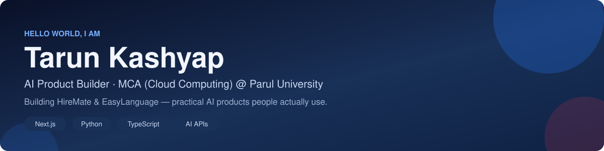
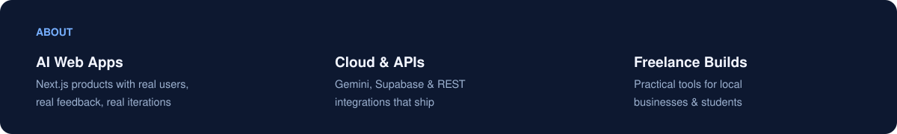
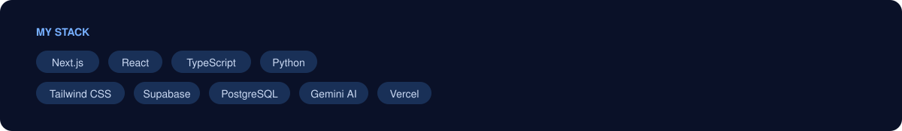
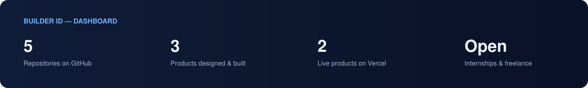

  

### Things I've built

| Project | What it does | Focus |
| :--- | :--- | :--- |
| [**HireMate**](https://github.com/Tarun-Kashyap74/mockmate) | AI mock-interview platform — voice & code answers, AI grading, STAR feedback | AI + Next.js |
| [**EasyLanguage**](https://easylanguage-five.vercel.app/) | Gamified coding-learning platform with visual node lessons | EdTech |
| [**CampusExchange**](https://github.com/Tarun-Kashyap74/wad) | Student marketplace to buy & sell used books on campus | Web App |

  <a href="https://www.linkedin.com/in/tarun-kumar-kashyap-1731a0245">LinkedIn</a> &nbsp;·&nbsp;
  <a href="https://mockmate-seven-zeta.vercel.app/">HireMate — Live</a> &nbsp;·&nbsp;
  <a href="https://easylanguage-five.vercel.app/">EasyLanguage — Live</a> &nbsp;·&nbsp;
  <a href="mailto:tarunkashyap7488@gmail.com">Email</a>

Build · Ship · Learn · Repeat

